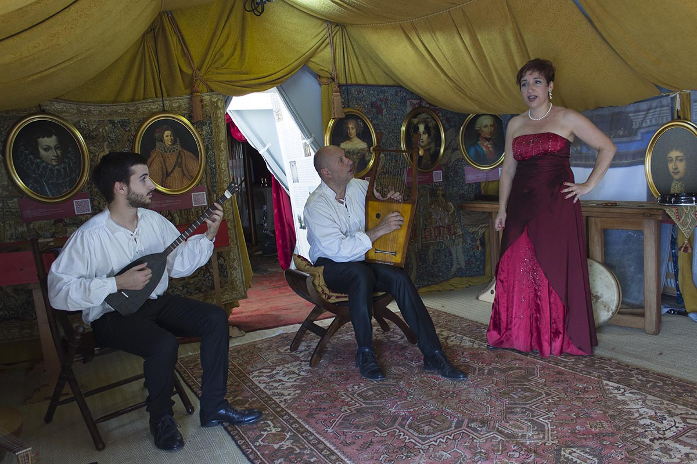

**Introduction**

Ancient Greece is celebrated not only for its philosophical and artistic achievements but also for its profound musical tradition. Music was an integral component of daily life, religious ceremonies, and theatrical performances. In this post, we will delve into the characteristics, instruments, and significance of music in ancient Greece, as well as explore its influence on the development of music in ancient Rome, particularly through the lens of the Schola Romana Ensemble.

The Schola Romana Ensemble performs the "Hymn to Nemesis" of Mesomedes of Crete (II c. AD), music from Emperor Hadrian, using specially reconstructed period instruments: Pandura and Kithara.

**The Role of Music in Ancient Greek Society**

Music played a vital role in ancient Greek culture, used in various social contexts, such as weddings, funerals, and festivals. It served as a means of expression and communication, conveying emotions that transcended spoken language. The Greeks believed that music could influence character and emotions, making it a fundamental component of education and moral development.

**Characteristics of Ancient Greek Music**

Ancient Greek music was distinguished by its use of modes and scales. The most common modes include:

1. **Dorian**
2. **Phrygian**
3. **Lydian**

These modes were believed to evoke specific emotions and moods, making them suitable for various occasions. The music was primarily monophonic, focusing on a single melody without harmonic accompaniment.

**Instruments of Ancient Greece**

The Greeks utilized a variety of musical instruments, both stringed and wind, such as:

- **Lyre**: A string instrument that played a significant role in social and ceremonial contexts.
- **Aulos**: A double-reeded wind instrument closely associated with Dionysian festivals.
- **Kithara**: A professional version of the lyre used in performances and competitions.

**The Influence on Roman Music**

The Schola Romana Ensemble focuses on the rich repertoire of ancient music, emphasizing the profound influence that ancient Greek music had on the development of music in ancient Rome. This ensemble explores how Greek modes, scales, and instruments played a crucial role in shaping Roman musical traditions, highlighting the interconnectedness of these two great civilizations.

**The Significance of Music in Theatrical Performances**

Music and drama were inseparable in ancient Greek theater, with choruses often singing and dancing to express the narrative. Great dramatists like Aeschylus, Sophocles, and Euripides incorporated extensive musical elements, which were crucial for storytelling and engaging the audience. This theatrical tradition laid the groundwork for Roman performances, blending the rich musical legacies of both cultures.

**Conclusion**

The legacy of ancient Greek music continues to influence contemporary music and remains a captivating subject for study. By understanding its characteristics, instruments, and cultural significance, as well as its impact on ancient Roman music, we can appreciate the depth of creativity that these ancient civilizations contributed to the world of music.
