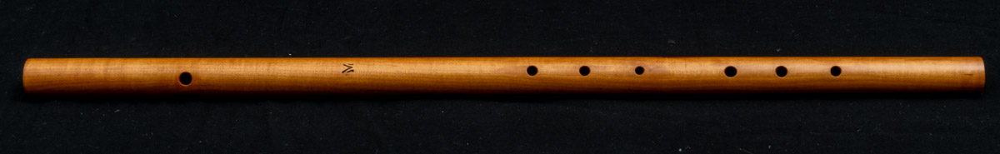
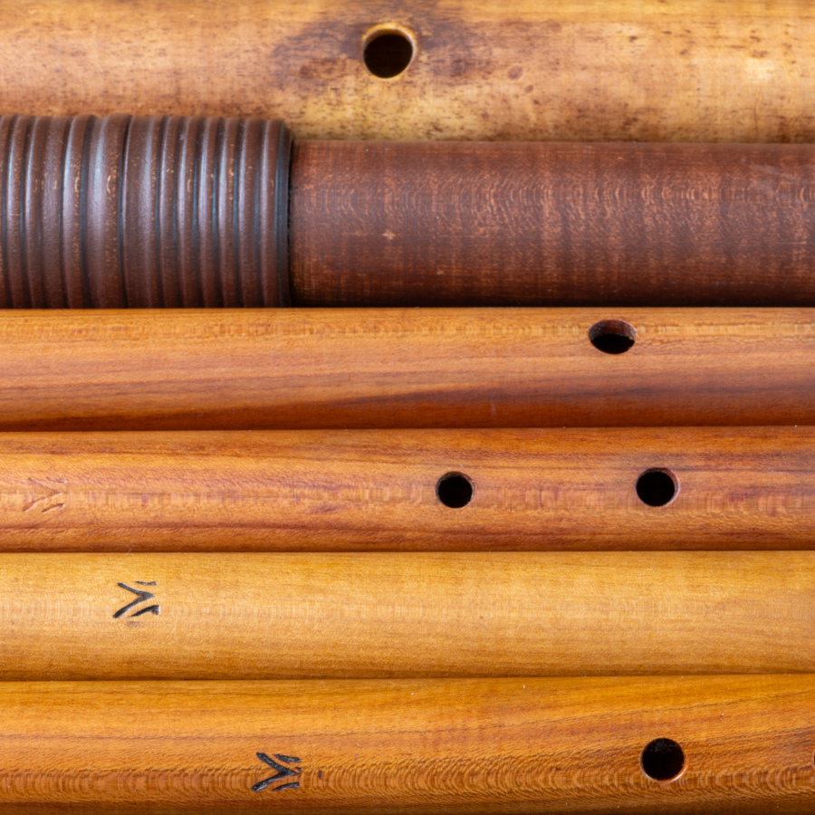

*Traversa rinascimentale tenore in Re (Pero), Costruttore: Vincenzo De Gregorio*

Negli strumenti a fiato il suono viene prodotto mettendo in vibrazione la colonna d'aria contenuta nello strumento, che di fatto si comporta come una corda. I modi per mettere in vibrazione questa colonna d'aria sono diversi: attraverso un'ancia (es. bombarde, cromorni, dulciane), con un'imboccatura a blocco (flauti dritti), a tazza (cornetti, tromboni) o, come nella traversa, soffiando direttamente contro lo spigolo del foro d'emissione, una modalità definita a "imboccatura libera". A differenza degli altri strumenti a fiato, quindi, nei flauti traversi nulla si frappone tra il fiato del musicista e la colonna vibrante.

Quello che giunge in età rinascimentale è uno strumento musicale erede di una evoluzione che si perde nella notte dei tempi. Il principio acustico dell'aria come corpo risonante è infatti noto dalla preistoria, come dimostrano diversi reperti archeologici, ricavati soprattutto da ossa di animali. Il legno, o altre materie vegetali come la canna o il bambù, sono stati impiegati per costruire flauti dalle epoche più remote, ma essendo questi materiali molto deperibili non abbiamo significativi reperti. I primi strumenti giunti fino a noi più o meno integri risalgono proprio all'epoca rinascimentale. Ciò ha dato la possibilità di rilevare con precisione le misure esterne e le camerature interne, le distanze e le dimensioni dei fori, le loro svasature. Su queste basi vengono ricostruiti gli strumenti che vengono messi oggi a disposizione dei flautisti.

*Traverse rinascimentali di diverse taglie. Costruttore: Vincenzo De Gregorio*

## Estensione e diteggiatura

La mancanza di un apparato di controllo del fiato, come un'ancia o un bocchino, è l'elemento che conferisce allo strumento il suo inconfondibile timbro, con un'estensione che copre due ottave più una quinta o, talvolta, qualche semitono in più.

La concezione minimalista e arcaica dello strumento – che oltre al foro d'emissione ha solo tre fori per la mano sinistra e tre per la destra–, determina oggettive problematiche esecutive, come la scarsa omogeneità timbrica tra le note "naturali", ottenute aprendo in successione i fori, e quelle "alterate", che richiedono diteggiature artificiose, come quelle cosiddette "a forchetta", o coprendo solo una porzione di determinati fori.

Tutto questo comporta anche poca fluidità nei passaggi rapidi che comprendono note alterate, mentre quando prevalgono note naturali lo strumento può muoversi con molta agilità.

Eccone un esempio tratto dal mio CD "[Labyrinthus](https://www.aulicusclassics.com/modern-classical-music/alc-0133-labyrinthus-music-for-renaissance-transverse-flute-consort)": la Recercada Segunda di Diego Ortiz, nel trasporto alla quinta sopra (l'originale è in sol).

<iframe src="https://www.youtube-nocookie.com/embed/9b-2jZdFD5g" title="YouTube video" loading="lazy" allowfullscreen allow="accelerometer; encrypted-media; picture-in-picture"></iframe>

## Intonazione

In uno strumento che impone una serie di compromessi strutturali, l'abilità del costruttore è determinante nell'intonare lo strumento, agendo sulla cameratura interna, la distanza tra i fori, la loro forma, il diametro e la svasatura.

Anche gli strumenti più riusciti richiedono al flautista una particolare attenzione nella gestione dell'intonazione. In particolare, le note tendenzialmente calanti si possono intonare scoprendo sensibilmente l’imboccatura e intensificando la pressione del fiato, cosa che rende però il timbro più soffioso; quelle crescenti, al contrario, si possono correggere coprendo sensibilmente l’imboccatura e riducendo il flusso del fiato, impoverendo di conseguenza volume e timbro.

Questi continui aggiustamenti impongono un'esecuzione più impegnativa rispetto ai futuri traversieri muniti di chiave, che inizieranno ad apparire solo dopo la metà del XVII sec., e rappresentano per il flautista una sfida affascinante, che rivela in ogni singolo esemplare caratteristiche uniche.
